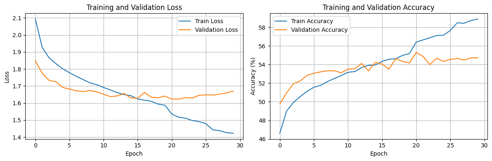
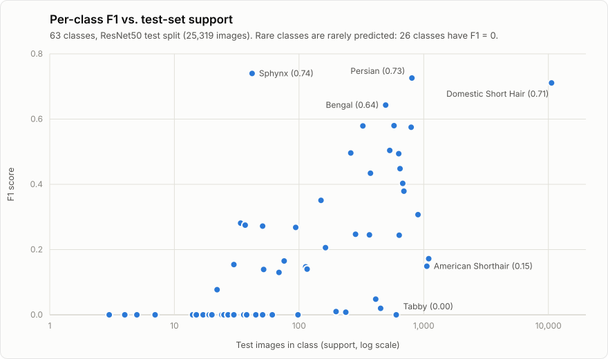
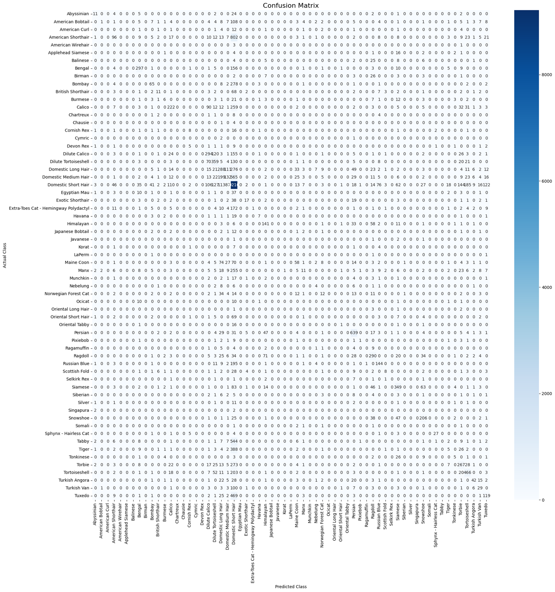

# Cat Breed Classifier

**Transfer-learning a ResNet50 to recognise 63 cat breeds from 126,591 real-world adoption photos, in PyTorch.**

[](https://www.python.org/)
[](https://pytorch.org/)
[](https://scikit-learn.org/)
[](notebooks/cat_breed_classifier.ipynb)
[](LICENSE)

English | [中文](#中文說明)

---

## Overview

Final project by Sheng-Wei Lu (呂聖韡) for the course *Artificial Intelligence and Deep Learning* at
Yuan Ze University. The goal was a complete image-classification pipeline: scan a large, unbalanced, folder-per-class dataset,
split it with stratification, fine-tune an ImageNet-pretrained CNN, and evaluate it with top-1 / top-5
accuracy, a per-class report and a confusion matrix.

The model reaches **54.69 % top-1** and **87.38 % top-5** accuracy on a held-out test set of 25,319 images
across 63 classes. The analysis below explains where the remaining errors come from (mostly class imbalance
and labels that describe coat colour rather than breed).

## Highlights

- End-to-end PyTorch pipeline: custom `Dataset`, stratified 70 / 10 / 20 split, augmentation, training loop
  with checkpointing, learning-rate scheduling and full test-set evaluation.
- Transfer learning on ResNet50: `conv1`-`layer3` frozen, `layer4` fine-tuned, new two-layer MLP head
  with dropout.
- Robust data loading: classes with fewer than 10 images are dropped automatically, unreadable images are
  replaced by a placeholder instead of crashing an epoch.
- Evaluation beyond accuracy: top-5 accuracy, per-class precision / recall / F1, a 63 x 63 confusion matrix
  and a list of every class pair confused more than 3 times (sorted by count in
  [`results/confused_pairs.txt`](results/confused_pairs.txt)).
- Utility script that uses a trained checkpoint to sort a folder of unsorted cat photos into breed folders.

## Dataset

[**Cat Breeds Dataset**](https://www.kaggle.com/datasets/ma7555/cat-breeds-dataset) by *ma7555* on Kaggle:
images of 67 breeds collected through the Petfinder API, labelled by the people who posted the adoption ads.

| Step | Result |
|---|---|
| Breed folders found | 67 |
| Dropped (< 10 images) | Burmilla (8), Canadian Hairless (4), Chinchilla (3), York Chocolate (1) |
| Classes used | **63** |
| Images used | **126,591** |
| Stratified split (seed 42) | train 88,613 / validation 12,659 / test 25,319 (70 / 10 / 20 %) |
| Largest class (training set) | Domestic Short Hair, 37,118 images (41.9 % of the training set) |

The dataset is **not** redistributed in this repository. It is published on Kaggle under
"Database: Open Database, Contents: Database Contents" (ODbL 1.0 / DbCL 1.0).

## Method

```
images/<Breed>/*.jpg
   -> count images per breed, drop breeds with < 10 images
   -> stratified train / val / test split (70 / 10 / 20, random_state = 42)
   -> train: RandomResizedCrop(128) + RandomHorizontalFlip + ImageNet normalisation
      eval : Resize(144) + CenterCrop(128) + ImageNet normalisation
   -> ResNet50 (ImageNet weights), layer4 + head trainable
   -> keep the checkpoint with the best validation accuracy
   -> test: top-1, top-5, classification report, confusion matrix
```

**Architecture**

| Part | Details | Trainable |
|---|---|---|
| Backbone | ResNet50, ImageNet-pretrained (`conv1` ... `layer3`) | frozen |
| Last stage | ResNet50 `layer4` | yes |
| Head | Dropout(0.5) -> Linear(2048, 512) -> ReLU -> Dropout(0.3) -> Linear(512, 63) | yes |

**Training setup**

| Setting | Value |
|---|---|
| Input size | 128 x 128 |
| Loss | Cross-entropy |
| Optimizer | Adam, learning rate 1e-3 |
| LR schedule | ReduceLROnPlateau on validation loss (patience 3, factor 0.5) |
| Epochs | 30 |
| Batch size | 256 (347 training iterations per epoch) |
| Model selection | best validation accuracy |
| Hardware | single CUDA GPU; most epochs took about 5-6 minutes (train + validation) |

## Results

| Metric (test set, 25,319 images) | Value |
|---|---|
| Top-1 accuracy | **54.69 %** |
| Top-5 accuracy | **87.38 %** |
| Weighted precision / recall / F1 | 0.483 / 0.547 / 0.487 |
| Macro precision / recall / F1 | 0.248 / 0.175 / 0.187 |
| Best validation accuracy | 55.30 % (epoch 21, checkpoint used for testing) |
| Final training accuracy / loss | 58.89 % / 1.4223 (epoch 30) |

For scale: Domestic Short Hair alone is 41.9 % of the test set (10,606 / 25,319 images), so always guessing
the majority class would score 41.9 % top-1. The 87.38 % top-5 accuracy shows that the correct breed is
usually among the model's leading candidates even when the first guess is wrong.

### Training curves



Training loss falls steadily (2.0930 -> 1.4223) while validation accuracy peaks at 55.30 % in epoch 21 and
then plateaus around 54-55 %. Validation loss reaches its minimum (1.6229) in epoch 22 and drifts back up to
1.6699, a sign of mild over-fitting in the last epochs. Per-epoch numbers: [`results/training_log.csv`](results/training_log.csv).

### Per-class performance



| Best classes | F1 | Test images |
|---|---|---|
| Sphynx - Hairless Cat | 0.740 | 42 |
| Persian | 0.726 | 804 |
| Domestic Short Hair | 0.711 | 10,606 |
| Bengal | 0.643 | 495 |
| Siamese | 0.580 | 578 |
| Snowshoe | 0.579 | 325 |
| Tortoiseshell | 0.575 | 793 |

26 of the 63 classes have F1 = 0 (1,211 test images in total), for example Tabby (602 images),
Oriental Short Hair (98), Egyptian Mau (61) and Birman (45). Visually distinctive breeds such as the hairless
Sphynx are recognised well even with few examples. Full report: [`results/classification_report.txt`](results/classification_report.txt).

### Confusion analysis



The dominant pattern is a strong pull toward the majority class:

| Actual -> predicted | Count |
|---|---|
| American Shorthair -> Domestic Short Hair | 802 |
| Domestic Medium Hair -> Domestic Short Hair | 565 |
| Tabby -> Domestic Short Hair | 544 |
| Tuxedo -> Domestic Short Hair | 469 |
| Tiger -> Domestic Short Hair | 388 |

Among the remaining errors, look-alike groups are confused with each other, for example
Dilute Calico -> Dilute Tortoiseshell (120), Calico -> Dilute Calico (90), Siamese -> Snowshoe (63),
Himalayan -> Ragdoll (58) and Snowshoe -> Siamese (47). All 290 pairs with more than 3 errors:
[`results/confused_pairs.txt`](results/confused_pairs.txt).

### Discussion and limitations

- **Class imbalance.** One class holds 41.9 % of the data, and 27 of the 63 classes have fewer than 50 test
  images. Plain cross-entropy without class weighting lets the model favour Domestic Short Hair.
- **Noisy, overlapping labels.** The dataset author notes that breeds were chosen by the advertisers, not by
  experts. Several classes (Tabby, Tiger, Tuxedo, Torbie, Calico, Tortoiseshell, ...) describe coat colour or
  pattern rather than breed and overlap with the "Domestic Short / Medium / Long Hair" classes.
- **Capacity limits.** Images are down-sampled to 128 x 128 and only `layer4` of the backbone is fine-tuned.

Next steps proposed in the project report: collect more images for rare breeds and use richer augmentation
(colour jitter, occlusion), try stronger backbones (EfficientNet, Vision Transformer), handle rare classes
explicitly during training, combine several models, and apply the classifier to live camera or video input.

## Project structure

```
cat-breed-classifier/
├── notebooks/
│   └── cat_breed_classifier.ipynb   # executed run: 30 epochs + test, all outputs kept
├── src/
│   ├── model.py                     # ResNet50 classifier + preprocessing transforms
│   ├── train.py                     # command-line training and evaluation
│   └── organize_cats.py             # sort a folder of photos into breed folders
├── results/
│   ├── classification_report.txt    # per-class precision / recall / F1 on the test set
│   ├── training_log.csv             # per-epoch loss and accuracy (from the notebook output)
│   └── confused_pairs.txt           # actual -> predicted pairs with more than 3 errors
├── assets/
│   ├── training_curves.png
│   ├── confusion_matrix.png
│   └── per_class_f1.svg
├── requirements.txt
├── LICENSE
└── README.md
```

## Getting started

### 1. Install

```bash
git clone https://github.com/ShengWei0528/cat-breed-classifier.git
cd cat-breed-classifier
python -m venv .venv
source .venv/bin/activate        # Windows: .venv\Scripts\activate
pip install -r requirements.txt  # for GPU training, install the CUDA build of torch first
```

### 2. Download the dataset

Download the archive from the [Kaggle page](https://www.kaggle.com/datasets/ma7555/cat-breeds-dataset)
(or with the Kaggle CLI: `kaggle datasets download -d ma7555/cat-breeds-dataset`) and extract it in the
repository root. You should get `images/<Breed name>/*.jpg` (67 folders) and `data/cats.csv`.
Both folders are git-ignored.

### 3. Train and evaluate

```bash
python src/train.py --data-dir images --output-dir outputs --epochs 30 --batch-size 256
```

`outputs/` will contain `best_model.pth`, `class_names.txt`, `training_log.csv`, `training_curves.png`,
`classification_report.txt` and `confusion_matrix.png`. Lower `--batch-size` if the GPU runs out of memory.
Re-running should give similar, but not bit-identical, numbers.

### 4. Sort your own cat photos

```bash
python src/organize_cats.py --model outputs/best_model.pth --classes outputs/class_names.txt \
    --input-dir path/to/unsorted --output-dir path/to/sorted --threshold 0.5
```

Images are copied (add `--move` to move them); predictions below the confidence threshold go to `unknown/`.

> **Model weights are not included.** The trained checkpoint (`best_model.pth`, about 99 MB) is too large
> to keep in a Git repository. Retrain it with step 3; the notebook shows the reference run.

### Notebook vs. scripts

[`notebooks/cat_breed_classifier.ipynb`](notebooks/cat_breed_classifier.ipynb) is the original executed run and
the source of every number in this README (only a local path was removed from its output).
`src/` is a tidied version of the same code with identical model, split and hyper-parameters. Changes:
command-line arguments and an output folder; `class_names.txt` and `training_log.csv` are now saved;
`weights=ResNet50_Weights.IMAGENET1K_V1` replaces the deprecated `pretrained=True` (same weights).
`organize_cats.py` now rebuilds the exact training architecture and 128-pixel preprocessing and loads the
checkpoint strictly. The earlier draft built a plain ResNet50 with a single linear head at 224 pixels and
loaded the checkpoint with `strict=False`; because the checkpoint keys are prefixed with `resnet.`, no
weights would actually have been loaded and the whole network would have stayed randomly initialised. The scripts were
syntax-checked but have not been re-run after the refactor.

## Tech stack

Python 3.12 · PyTorch · torchvision (ResNet50) · scikit-learn · NumPy · Matplotlib · seaborn · Pillow · tqdm · Jupyter

## Context

- Course: 人工智慧與深度學習 (*Artificial Intelligence and Deep Learning*), final project
- School: Department of Electrical Engineering, Yuan Ze University (元智大學), Taiwan
- Term: Spring 2025 (third year, second semester)

## Credits

- Author: Sheng-Wei Lu (呂聖韡).
- Dataset: [Cat Breeds Dataset](https://www.kaggle.com/datasets/ma7555/cat-breeds-dataset) by ma7555 (Kaggle),
  images via the Petfinder API; ODbL 1.0 / DbCL 1.0. Not redistributed here.
- Model: K. He, X. Zhang, S. Ren, J. Sun, "Deep Residual Learning for Image Recognition", CVPR 2016.
  Pretrained ImageNet weights loaded via [torchvision](https://pytorch.org/vision/stable/models.html)
  (library: BSD-3-Clause; the weights may carry their own terms from the ImageNet training data).
- Background: J. Yosinski et al., "How transferable are features in deep neural networks?", NeurIPS 2014.

## License

Code in this repository is released under the [MIT License](LICENSE). The dataset keeps its own license
(see above); the figures and result files were generated from this project's own training run.

---

<a id="中文說明"></a>

# 貓咪品種辨識系統（中文說明）

**以 PyTorch 對 ResNet50 進行遷移學習，從 126,591 張真實送養照片中辨識 63 種貓咪品種。**

[English](#cat-breed-classifier) | 中文

## 專案概述

這是呂聖韡（Sheng-Wei Lu）在元智大學「人工智慧與深度學習」課程的期末專題。目標是完成一條完整的影像分類流程：
讀取大型、類別不平衡、每類一個資料夾的資料集，以分層抽樣切分資料，微調 ImageNet 預訓練 CNN，
並以 Top-1 / Top-5 準確率、各類別分類報告與混淆矩陣評估模型。

模型在 63 個類別、25,319 張的獨立測試集上達到 **Top-1 準確率 54.69%**、**Top-5 準確率 87.38%**。
下方的分析說明剩餘錯誤的主要來源（類別不平衡，以及部分標籤描述的是毛色而非品種）。

## 重點特色

- 完整的 PyTorch 流程：自訂 `Dataset`、70 / 10 / 20 分層切分、資料增強、含模型存檔與學習率調整的訓練迴圈，以及完整的測試集評估。
- ResNet50 遷移學習：凍結 `conv1`～`layer3`，微調 `layer4`，並換上含 Dropout 的兩層全連接分類頭。
- 穩健的資料讀取：自動排除圖片少於 10 張的品種；無法讀取的圖片以黑色預設圖取代，不會中斷訓練。
- 不只看準確率：Top-5 準確率、各類別 precision / recall / F1、63 x 63 混淆矩陣，以及所有錯誤次數大於 3 的混淆品種配對（在 [`results/confused_pairs.txt`](results/confused_pairs.txt) 中依次數排序）。
- 附工具腳本：用訓練好的模型把一整個資料夾的貓咪照片依預測品種自動分類到子資料夾。

## 資料集

Kaggle 上由 *ma7555* 發布的 [**Cat Breeds Dataset**](https://www.kaggle.com/datasets/ma7555/cat-breeds-dataset)：
透過 Petfinder API 蒐集的 67 個品種貓咪照片，品種標籤由刊登送養廣告的人填寫。

| 步驟 | 結果 |
|---|---|
| 品種資料夾 | 67 個 |
| 排除（少於 10 張） | Burmilla（8）、Canadian Hairless（4）、Chinchilla（3）、York Chocolate（1） |
| 使用類別數 | **63** |
| 使用圖片數 | **126,591** |
| 分層切分（seed 42） | 訓練 88,613／驗證 12,659／測試 25,319（70 / 10 / 20%） |
| 最大類別（訓練集） | Domestic Short Hair（家貓短毛），37,118 張，佔訓練集 41.9% |

本儲存庫**不**重新散布資料集。資料集在 Kaggle 上的授權為「Database: Open Database, Contents: Database Contents」（ODbL 1.0 / DbCL 1.0）。

## 方法

```
images/<品種>/*.jpg
   -> 統計各品種圖片數，排除少於 10 張的品種
   -> 分層切分 訓練 / 驗證 / 測試（70 / 10 / 20，random_state = 42）
   -> 訓練：RandomResizedCrop(128) + RandomHorizontalFlip + ImageNet 標準化
      評估：Resize(144) + CenterCrop(128) + ImageNet 標準化
   -> ResNet50（ImageNet 權重），只訓練 layer4 與分類頭
   -> 保留驗證準確率最高的模型
   -> 測試：Top-1、Top-5、分類報告、混淆矩陣
```

**模型架構**

| 部分 | 內容 | 是否訓練 |
|---|---|---|
| 骨幹網路 | ResNet50，ImageNet 預訓練（`conv1` ... `layer3`） | 凍結 |
| 最後殘差區塊 | ResNet50 `layer4` | 是 |
| 分類頭 | Dropout(0.5) -> Linear(2048, 512) -> ReLU -> Dropout(0.3) -> Linear(512, 63) | 是 |

**訓練設定**

| 項目 | 設定 |
|---|---|
| 輸入尺寸 | 128 x 128 |
| 損失函數 | 交叉熵（Cross-entropy） |
| 優化器 | Adam，學習率 1e-3 |
| 學習率調整 | 依驗證損失使用 ReduceLROnPlateau（patience 3，factor 0.5） |
| 訓練輪數 | 30 |
| 批次大小 | 256（每輪 347 個訓練 iteration） |
| 模型選擇 | 驗證準確率最高者 |
| 硬體 | 單張 CUDA GPU；多數 epoch 約 5～6 分鐘（訓練 + 驗證） |

## 實驗結果

| 指標（測試集，25,319 張） | 數值 |
|---|---|
| Top-1 準確率 | **54.69%** |
| Top-5 準確率 | **87.38%** |
| 加權 precision / recall / F1 | 0.483 / 0.547 / 0.487 |
| 巨觀平均（macro）precision / recall / F1 | 0.248 / 0.175 / 0.187 |
| 最佳驗證準確率 | 55.30%（第 21 個 epoch，測試即使用此模型） |
| 最終訓練準確率 / 損失 | 58.89% / 1.4223（第 30 個 epoch） |

作為參考：測試集中光是 Domestic Short Hair 就佔 41.9%（10,606 / 25,319 張），因此永遠猜最多數類別即可得到 41.9% 的 Top-1。
Top-5 準確率 87.38% 代表即使第一個猜測錯誤，正確品種通常仍在模型的前幾名候選之中。

### 訓練曲線


訓練損失穩定下降（2.0930 -> 1.4223），驗證準確率在第 21 個 epoch 達到最高 55.30%，之後持平在 54～55% 左右。
驗證損失在第 22 個 epoch 達到最低（1.6229），之後回升至 1.6699，顯示最後幾輪有輕微過擬合。
逐輪數據見 [`results/training_log.csv`](results/training_log.csv)。

### 各類別表現


| 表現最好的類別 | F1 | 測試圖片數 |
|---|---|---|
| Sphynx - Hairless Cat（斯芬克斯無毛貓） | 0.740 | 42 |
| Persian（波斯貓） | 0.726 | 804 |
| Domestic Short Hair（家貓短毛） | 0.711 | 10,606 |
| Bengal（孟加拉貓） | 0.643 | 495 |
| Siamese（暹羅貓） | 0.580 | 578 |
| Snowshoe（雪鞋貓） | 0.579 | 325 |
| Tortoiseshell（玳瑁貓） | 0.575 | 793 |

63 個類別中有 26 個 F1 = 0（合計 1,211 張測試圖片），例如 Tabby（602 張）、Oriental Short Hair（98）、
Egyptian Mau（61）、Birman（45）。外觀特徵鮮明的品種（如無毛的 Sphynx）即使樣本少也能辨識得不錯。
完整報告見 [`results/classification_report.txt`](results/classification_report.txt)。

### 混淆分析


最明顯的現象是預測強烈偏向多數類別：

| 實際 -> 預測 | 次數 |
|---|---|
| American Shorthair -> Domestic Short Hair | 802 |
| Domestic Medium Hair -> Domestic Short Hair | 565 |
| Tabby -> Domestic Short Hair | 544 |
| Tuxedo -> Domestic Short Hair | 469 |
| Tiger -> Domestic Short Hair | 388 |

其餘錯誤多發生在外觀相近的品種之間，例如 Dilute Calico -> Dilute Tortoiseshell（120）、Calico -> Dilute Calico（90）、
Siamese -> Snowshoe（63）、Himalayan -> Ragdoll（58）、Snowshoe -> Siamese（47）。錯誤次數大於 3 的 290 組配對見
[`results/confused_pairs.txt`](results/confused_pairs.txt)。

### 討論與限制

- **類別不平衡**：單一類別佔資料的 41.9%，且 63 類中有 27 類的測試圖片少於 50 張。未加權的交叉熵讓模型偏好預測 Domestic Short Hair。
- **標籤雜訊與重疊**：資料集作者說明品種是由刊登者填寫，並非專家標註。部分類別（Tabby、Tiger、Tuxedo、Torbie、Calico、Tortoiseshell 等）描述的是毛色或花紋而非品種，且與「Domestic Short / Medium / Long Hair」類別互相重疊。
- **模型容量限制**：影像縮小至 128 x 128，且骨幹網路只微調 `layer4`。

專題報告中提出的未來方向：為稀有品種蒐集更多圖片並使用更多元的資料增強（顏色抖動、遮擋等）、嘗試更強的骨幹網路（EfficientNet、Vision Transformer）、
在訓練中特別處理少樣本類別、結合多個模型，以及將分類器應用於即時攝影機或影片串流。

## 專案結構

```
cat-breed-classifier/
├── notebooks/
│   └── cat_breed_classifier.ipynb   # 已執行的完整紀錄：30 個 epoch + 測試，保留所有輸出
├── src/
│   ├── model.py                     # ResNet50 分類模型與前處理
│   ├── train.py                     # 命令列訓練與評估
│   └── organize_cats.py             # 依預測品種整理照片資料夾
├── results/
│   ├── classification_report.txt    # 測試集各類別 precision / recall / F1
│   ├── training_log.csv             # 逐輪損失與準確率（取自 notebook 輸出）
│   └── confused_pairs.txt           # 錯誤次數大於 3 的「實際 -> 預測」配對
├── assets/
│   ├── training_curves.png
│   ├── confusion_matrix.png
│   └── per_class_f1.svg
├── requirements.txt
├── LICENSE
└── README.md
```

## 使用方式

### 1. 安裝

```bash
git clone https://github.com/ShengWei0528/cat-breed-classifier.git
cd cat-breed-classifier
python -m venv .venv
source .venv/bin/activate        # Windows：.venv\Scripts\activate
pip install -r requirements.txt  # 若要用 GPU 訓練，請先安裝 CUDA 版的 torch
```

### 2. 下載資料集

從 [Kaggle 頁面](https://www.kaggle.com/datasets/ma7555/cat-breeds-dataset) 下載壓縮檔
（或使用 Kaggle CLI：`kaggle datasets download -d ma7555/cat-breeds-dataset`），並解壓縮到儲存庫根目錄，
應得到 `images/<品種名稱>/*.jpg`（67 個資料夾）與 `data/cats.csv`。這兩個資料夾已列入 `.gitignore`。

### 3. 訓練與評估

```bash
python src/train.py --data-dir images --output-dir outputs --epochs 30 --batch-size 256
```

`outputs/` 會產生 `best_model.pth`、`class_names.txt`、`training_log.csv`、`training_curves.png`、
`classification_report.txt` 與 `confusion_matrix.png`。GPU 記憶體不足時請調小 `--batch-size`。
重新訓練的數字應相近，但不會逐位元相同。

### 4. 整理你自己的貓咪照片

```bash
python src/organize_cats.py --model outputs/best_model.pth --classes outputs/class_names.txt \
    --input-dir path/to/unsorted --output-dir path/to/sorted --threshold 0.5
```

預設為複製檔案（加上 `--move` 改為移動）；信心值低於門檻的圖片會放到 `unknown/`。

> **不含模型權重。** 訓練好的 `best_model.pth`（約 99 MB）太大，不適合放進 Git 儲存庫。請依步驟 3 重新訓練；notebook 中保留了參考執行結果。

### Notebook 與腳本的差異

[`notebooks/cat_breed_classifier.ipynb`](notebooks/cat_breed_classifier.ipynb) 是原始的執行紀錄，也是本說明中所有數字的來源
（僅移除輸出中的一個本機路徑）。`src/` 是同一份程式碼整理後的版本，模型、資料切分與超參數完全相同。修改內容：
加入命令列參數與輸出資料夾；新增輸出 `class_names.txt` 與 `training_log.csv`；以 `weights=ResNet50_Weights.IMAGENET1K_V1`
取代已棄用的 `pretrained=True`（同一組權重）。`organize_cats.py` 現在會重建與訓練時完全相同的架構與 128 像素前處理，並以嚴格模式載入權重；
先前的草稿版本建立的是單層線性分類頭、224 像素輸入的 ResNet50，且以 `strict=False` 載入；由於權重檔的參數名稱都帶有 `resnet.` 前綴，實際上不會載入任何權重，整個網路都會維持隨機初始化。
整理後的腳本已通過語法檢查，但尚未重新執行訓練。

## 使用技術

Python 3.12 · PyTorch · torchvision（ResNet50）· scikit-learn · NumPy · Matplotlib · seaborn · Pillow · tqdm · Jupyter

## 專題背景

- 課程：人工智慧與深度學習（*Artificial Intelligence and Deep Learning*）期末專題
- 學校：元智大學 電機工程學系
- 學期：2025 年春季（大三下學期）

## 致謝

- 作者：呂聖韡（Sheng-Wei Lu）。
- 資料集：Kaggle 上 ma7555 的 [Cat Breeds Dataset](https://www.kaggle.com/datasets/ma7555/cat-breeds-dataset)，圖片來自 Petfinder API；授權 ODbL 1.0 / DbCL 1.0，本儲存庫不重新散布。
- 模型：K. He、X. Zhang、S. Ren、J. Sun，“Deep Residual Learning for Image Recognition”，CVPR 2016；預訓練 ImageNet 權重透過 [torchvision](https://pytorch.org/vision/stable/models.html) 載入（函式庫授權為 BSD-3-Clause；權重本身可能另受 ImageNet 訓練資料的使用條款約束）。
- 參考：J. Yosinski 等，“How transferable are features in deep neural networks?”，NeurIPS 2014。

## 授權

本儲存庫的程式碼以 [MIT License](LICENSE) 釋出。資料集沿用其原始授權（見上方）；圖表與結果檔皆由本專題自己的訓練執行產生。
